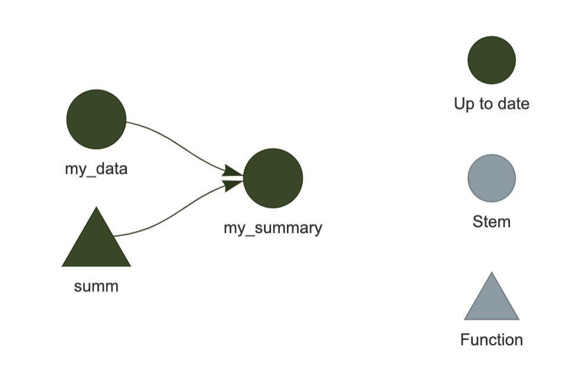

:::::::::::::::::::::::::::::::::::::: questions 

- What happens if we re-run a workflow?
- How does `targets` know what steps to re-run?
- How can we inspect the state of the workflow?

::::::::::::::::::::::::::::::::::::::::::::::::

::::::::::::::::::::::::::::::::::::: objectives

- Explain how `targets` helps increase efficiency
- Be able to inspect a workflow to see what parts are outdated

::::::::::::::::::::::::::::::::::::::::::::::::

::::::::::::::::::::::::::::::::::::: {.instructor}

Episode summary: Demonstrate typical cycle of running `targets`: make, inspect, adjust, make...

:::::::::::::::::::::::::::::::::::::

```{r}
#| label: setup
#| echo: FALSE
#| message: FALSE
#| warning: FALSE
library(targets)
library(visNetwork)
source("files/lesson_functions.R")
```

## Re-running the workflow

One of the features of `targets` is that it maximizes efficiency by only running the parts of the workflow that need to be run.

This is easiest to understand by trying it yourself. Let's try running the workflow again:

```{r}
#| label: targets-run
#| echo: [5]
# Each tar_script is fresh, so need to run once to catch up to learners
pushd(make_tempdir())
write_example_plan("plan_1.R")
tar_make(reporter = "silent")
tar_make()
popd()
```

Remember how the first time we ran the pipeline, `targets` printed out a list of each target as it was being built?

This time, it tells us it is skipping those targets; they have already been built, so there's no need to run that code again.

Remember, the fastest code is the code you don't have to run!

## Re-running the workflow after modification

What happens when we change one part of the workflow then run it again?

Say that we decide the species names should be shorter.
Right now they include the common name and the scientific name, but we really only need the first part of the common name to distinguish them.

Edit `_targets.R` so that the `clean_penguin_data()` function looks like this:

```{r}
#| label: new-func
#| eval: FALSE
#| file: files/tar_functions/clean_penguin_data.R
```

Then run it again.

```{r}
#| label: targets-run-2
#| echo: [6]
plan_2_dir <- make_tempdir()
pushd(plan_2_dir)
write_example_plan("plan_1.R")
tar_make(reporter = "silent")
write_example_plan("plan_2.R")
tar_make()
popd()
```

What happened?

This time, it skipped `penguins_csv_file` and `penguins_data_raw` and only ran `penguins_data`.

Of course, since our example workflow is so short we don't even notice the amount of time saved.
But imagine using this in a series of computationally intensive analysis steps.
The ability to automatically skip steps results in a massive increase in efficiency.

::::::::::::::::::::::::::::::::::::: challenge

## Challenge 1: Inspect the output

How can you inspect the contents of `penguins_data`?

:::::::::::::::::::::::::::::::::: solution

By running `tar_load(penguins_data)` followed by `penguins_data`.

::::::::::::::::::::::::::::::::::::::::::::

:::::::::::::::::::::::::::::::::::::::::::::::

## Under the hood

How does `targets` keep track of which targets are up-to-date vs. outdated?

For each target in the workflow (items in the list at the end of the `_targets.R` file) and any custom functions used in the workflow, `targets` calculates a **hash value**, or unique combination of letters and digits that represents an object in the computer's memory.
You can think of the hash value (or "hash" for short) as **a unique fingerprint** for a target or function.

The first time your run `tar_make()`, `targets` calculates the hashes for each target and function as it runs the code and stores them in the targets cache (the `_targets` folder).
Then, for each subsequent call of `tar_make()`, it calculates the hashes again and compares them to the stored values.
It detects which have changed, and this is how it knows which targets are out of date.

:::::::::::::::::::::::::::::::::::::::: callout

## Where the hashes live

If you are curious about what the hashes look like, you can see them in the file `_targets/meta/meta`, but **do not edit this file by hand**---that would ruin your workflow!

::::::::::::::::::::::::::::::::::::::::

This information is used in combination with the dependency relationships (in other words, how each target depends on the others) to re-run the workflow in the most efficient way possible: code is only run for targets that need to be re-built, and others are skipped.

## Visualizing the workflow

Typically, you will be making edits to various places in your code, adding new targets, and running the workflow periodically.
It is good to be able to visualize the state of the workflow.

This can be done with `tar_visnetwork()`

```{r}
#| label: targets-run-hide-3
#| echo: [5]
#| results: "asis"
#| eval: FALSE
# TODO: Change #| eval to TRUE when
# https://github.com/carpentries/sandpaper/issues/443
# is resolved
pushd(plan_2_dir)
tar_visnetwork()
popd()
```

{alt="Visualization of the targets worklow, showing 'penguins_data' connected by lines to 'penguins_data_raw', 'penguins_csv_file' and 'clean_penguin_data'"}

You should see the network show up in the plot area of RStudio.

It is an HTML widget, so you can zoom in and out (this isn't important for the current example since it is so small, but is useful for larger, "real-life" workflows).

Here, we see that all of the targets are dark green, indicating that they are up-to-date and would be skipped if we were to run the workflow again.

::::::::::::::::::::::::::::::::::::: prereq 

## Installing visNetwork

You may encounter an error message `The package "visNetwork" is required.`

In this case, install it first with `install.packages("visNetwork")`.

::::::::::::::::::::::::::::::::::::::::::::::::

::::::::::::::::::::::::::::::::::::: challenge

## Challenge 2: What else can the visualization tell us?

Modify the workflow in `_targets.R`, then run `tar_visnetwork()` again **without** running `tar_make()`.
What color indicates that a target is out of date?

For example, you could delete the argument `show_col_types = FALSE` from the `read_csv()` call in the `penguins_data_raw` target.
This changes the code but not the data, so it won't break anything.

:::::::::::::::::::::::::::::::::: solution

Light blue indicates the target is out of date.

With the modification above, `penguins_data_raw` and `penguins_data` are light blue: `penguins_data_raw` because its code changed, and `penguins_data` because it depends on `penguins_data_raw`. `penguins_csv_file` stays green because nothing it depends on changed.
If you modify the code a different way, a different set of targets may be light blue.

::::::::::::::::::::::::::::::::::::::::::::

:::::::::::::::::::::::::::::::::::::::::::::::

::::::::::::::::::::::::::::::::::::: callout

## 'Outdated' does not always mean 'will be run'

Just because a target appears as light blue (is "outdated") in the network visualization, this does not guarantee that it will be re-built during the next run. Rather, it means that **at least one of the targets that it depends on has changed**.

For example, if the workflow state looked like this:

`A -> B* -> C -> D`

where the `*` indicates that `B` has changed compared to the last time the workflow was run, the network visualization will show `B`, `C`, and `D` all as light blue.

But if re-running the workflow results in the exact same value for `C` as before, `D` will not be re-run (will be "skipped").

Most of the time, a single change will cascade to the rest of the downstream targets and cause them to be re-built, but this is not always the case. `targets` has no way of knowing ahead of time what the actual output will be, so it cannot provide a network visualization that completely predicts the future!

We can see this with the modification from Challenge 2. Both `penguins_data_raw` and `penguins_data` showed up as outdated, but what happens when we run the workflow?

```{r}
#| label: targets-modify-2
#| echo: [3]
pushd(plan_2_dir)
write_example_plan("plan_2c.R")
tar_make()
popd()
```

Only `penguins_data_raw` was re-run (the extra message is from `read_csv()`, which now reports the column types because we removed `show_col_types = FALSE`). Its code changed, so it was re-built, but it produced exactly the same data as before. That means `penguins_data`, which looked outdated, was skipped.

:::::::::::::::::::::::::::::::::::::::::::::::

## Granular control of targets

It is possible to only make a particular target instead of running the entire workflow.

To do this, type the name of the target you wish to build after `tar_make()` (note that any targets required by the one you specify will also be built).
For example, `tar_make(penguins_data_raw)` would **only** build `penguins_data_raw`, not `penguins_data`.

Furthermore, if you want to manually "reset" a target and make it appear out-of-date, you can do so with `tar_invalidate()`. This means that target (and any that depend on it) will be re-run next time.

Let's give this a try. Remember that our pipeline is currently up to date, so `tar_make()` will skip everything:

```{r}
#| label: targets-progress-show-2
#| eval: true
#| echo: [2]
pushd(plan_2_dir)
tar_make()
popd()
```

Now let's invalidate `penguins_data_raw` and build only that target:

```{r}
#| label: targets-specific-show
#| eval: true
#| echo: [2, 3]
pushd(plan_2_dir)
tar_invalidate(penguins_data_raw)
tar_make(penguins_data_raw)
popd()
```

Only `penguins_data_raw` was built (you will see the same `read_csv()` message again, since we are still not using `show_col_types = FALSE`). `penguins_data` was not part of this run, and `penguins_csv_file` (which `penguins_data_raw` depends on) was skipped because it was already up to date.

Next, let's invalidate `penguins_data` and run the whole workflow again:

```{r}
#| label: targets-progress-show-3
#| eval: true
#| echo: [2, 3]
pushd(plan_2_dir)
tar_invalidate(penguins_data)
tar_make()
popd()
```

If you want to reset **everything** and start fresh, you can use `tar_invalidate(everything())` (`tar_invalidate()` [accepts `tidyselect` expressions](https://docs.ropensci.org/targets/reference/tar_invalidate.html) to specify target names).

**Caution should be exercised** when using granular methods like this, though, since you may end up with your workflow in an unexpected state. The surest way to maintain an up-to-date workflow is to run `tar_make()` frequently.

## Restoring your workflow

In Challenge 2 we removed `show_col_types = FALSE` from the `read_csv()` call in `penguins_data_raw`.
Before moving on, put it back in your `_targets.R`, so that your workflow matches the one we will use in the following episodes.
The `penguins_data_raw` target should look like this again:

```r
tar_target(penguins_data_raw, read_csv(
  penguins_csv_file, show_col_types = FALSE))
```

Then run `tar_make()` to bring everything up to date.
`penguins_data_raw` will be re-built because its code changed, but `penguins_data` will be skipped because the data is the same.

## How this all works in practice

In practice, you will likely be switching between running the workflow with `tar_make()`, loading the targets you built with `tar_load()`, and editing your custom functions by running code in an interactive R session. It takes some time to get used to it, but soon you will feel that your code isn't "real" until it is embedded in a `targets` workflow.

::::::::::::::::::::::::::::::::::::: keypoints 

- `targets` only runs the steps that have been affected by a change to the code
- `tar_visnetwork()` shows the current state of the workflow as a network
- `tar_invalidate()` can be used to invalidate (re-run) specific targets

::::::::::::::::::::::::::::::::::::::::::::::::
